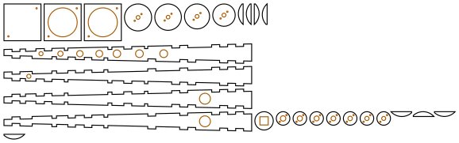

# Bagpipe chanter

<!-- readme-only -->
**[Read the writeup](https://gernreich.github.io/ghb-chanter/)** ·
**[Turn it in 3D](https://gernreich.github.io/ghb-chanter/#turn-it-in-3d)**

<!-- page-only **[Read the README](https://github.com/Gernreich/ghb-chanter)** -->

A full Great Highland bagpipe chanter in 3mm plywood. Its conical bore is a tapering
square of four long strips, finger-jointed and glued, from the sole up into a collar
of stacked plates. The tenon above the collar holds the reed's seat and goes into the
chanter stock. It is the
[standard strip chanter](https://gernreich.github.io/practice-chanters/#the-standard-strip-chanter)
taken to a full chanter: four long strips round a square bore, with a real chanter's
holes.

The real chanter is Jeremy Starcher's
[Dis-Enchanter](https://www.thingiverse.com/thing:2373962) (2017), a 3D-printed chanter
that its designer copied from a 1970s Hardie. Its bore, holes, collar and sole are
measured from its STL, and this chanter keeps every hole where the Dis-Enchanter's is.

Output is millimetre-true — `1 user unit = 1mm` with a physical `width`/`height` — so
it prints and cuts at real size.

**It has not been cut or played yet.** The Dis-Enchanter is a model to follow, not a
proven scale: its designer calls it mostly working, with F and G low on the first print.
The holes here are sized by an acoustic model that cannot reproduce a real chanter's
scale, used only for the difference between this chanter and the Dis-Enchanter.
[Before you cut](#before-you-cut) says what that costs.

<table>
<tr>
<td align="center"><a href="cut-files/ghb-chanter-sheet1-cut-files.svg"></a></td>
</tr>
<tr>
<td align="center">The whole chanter on one 578 × 181mm sheet.</td>
</tr>
</table>

## The chanter

| | |
|---|---|
| Bore | the Dis-Enchanter's cone made square, the same area at every height: 4.57mm square where the strips meet the collar, 18.76mm at the sole, against its 5.16 to 21.17mm round. Each face leans 1.3° |
| Strips | 312mm long, tapering, finger-jointed, glued. Round each hole its strip owns both corners, so the hole has ply all round |
| Holes | where the Dis-Enchanter's are: seven in the front strip, high A in the back, and a side hole in each side strip near the sole |
| Foot | two layers of four flat strips round the strips' bottom, cut to the Dis-Enchanter's 36.5mm sole: 6mm tall, its sole 7.25mm |
| Collar | the Dis-Enchanter's bead, plate by plate: 34.1, 33.3, 31.5 and 28.2mm round plates with its 4.8 to 5.1mm throat, then a 23.1mm plate the strips' top stands in |
| Tenon | 7 round plates 17mm across, with the reed's seat tapering 7.0 to 5.2mm through them, the Dis-Enchanter's taper. Hemp it into the stock |
| Joints | the strips, foot and collar's socket plate glued; the collar's round plates and the tenon press-fit on two 2mm pins; the seams sealed with shellac |
| Jig | a 46.5mm square base and two rings with a 36.8mm hole, pinned into a cup, to glue the foot up in; not part of the chanter |
| Sheet | one 578 × 181mm sheet of 3mm ply, 27 parts with the jig |

| Hole | Down from the seat's top | This chanter | Its face | The Dis-Enchanter |
|---|---|---|---|---|
| high A, back | 64.3mm | 5.32mm | 5.99mm | 4.80mm |
| high G | 79.6mm | 5.35mm | 6.69mm | 4.80mm |
| F | 104.1mm | 6.81mm | 7.80mm | 6.00mm |
| E | 128.6mm | 8.15mm | 8.92mm | 7.15mm |
| D | 153.1mm | 8.72mm | 10.03mm | 7.20mm |
| C | 175.3mm | 9.61mm | 11.04mm | 7.90mm |
| B | 203.6mm | 9.86mm | 12.33mm | 7.85mm |
| low A | 234.2mm | 9.97mm | 13.72mm | 7.85mm |
| side holes, both | 286.2mm | 13.95mm | 16.09mm | 9.60mm |

**Why the holes are bigger.** The Dis-Enchanter's wall is 2mm everywhere. A strip is
3mm, and a hole through a thicker wall sounds flatter, so each hole is opened up until
its note sounds where the Dis-Enchanter's does, in the model. The side holes set low G,
so they are sized for it the same way. High A's hole comes within 0.68mm of its face's
edges. That is why its strip owns both corners there: the fingers round it are the
strip's own ply.

**Why there is no butt-jointed version.** The practice chanters have one. Here the holes
are too wide for their faces: with butt joints, high A and the side holes would have
under a millimetre of ply beside them before a glue line.

## Before you cut

- **The scale is the model's, not a measured one.** The model sounds the Dis-Enchanter's
  own notes 2 to 3 semitones apart from a real chanter's at the top, so it cannot set a
  pitch. It sizes each hole for the difference a 3mm strip wall makes. If the
  Dis-Enchanter's scale is right, this one should be close; its designer found F and G
  low.
- **The reed decides the pitch.** A Great Highland chanter reed sits in the seat; move it
  in or out to set low A, as on any chanter.
- **The ply must be 3mm.** Measure it. A strip's thickness is the holes' wall, and the
  holes were sized for 3mm. Pass `--plate=` with what you measured.
- **Holes open, never close.** Tune a flat note by opening its hole with a file. A sharp
  one needs tape.

## Building it

1. Cut the sheet. Dry-fit the four strips first. Each strip's two edges have different
   finger patterns, so it goes in only one way. The strips taper, so the wide ends all go
   to the sole.
2. Glue the strips round a waxed, tapering former, or round a waxed drill bit, to keep
   glue out of the bore. Clamp lightly and wipe off any glue that squeezes out.
3. Press the jig's base and two rings together on two 2mm pins, and line the cup with
   packing tape or wax so the glue cannot stick to it. Stand the chanter in it on its
   sole. Glue the foot's layers in round the strips one at a time, the circle centring
   each. Each piece runs round one corner of the circle to the inner corner beyond. Each
   layer turns the other way from the one below, so no seam runs through.
4. Glue the strips' top 3mm into the collar's socket plate, and that plate to the
   collar's round plates above it, widest last.
5. Press the collar's round plates and the tenon together on two 2mm pins. Cut the pins
   flush with the collar's bottom face. Their ends land on the strips' top, inside the
   socket plate.
6. Seal the bore with shellac on a pipe cleaner, and let it dry. Brush the seams outside.
7. Hemp the tenon into the chanter stock. Push the reed's staple into the seat.

## Turn it in 3D

[turn.html](turn.html) shows the chanter as solid parts you can drag to turn and pull
apart, each the cut file's own outline.

<!-- page-only <iframe src="turn.html" title="The bagpipe chanter as solid parts you can drag to turn and pull apart: four darker tapering strips with finger-jointed edges and a row of holes along the front, a stack of round collar plates and a narrower tenon at the narrow end, and a round foot at the wide end" style="width:100%;height:560px;border:0"></iframe> -->

## Regenerating

```
python3 ghb_chanter.py --no-write                # the checks
python3 ghb_chanter.py --out=cut-files           # the sheet
python3 ghb_chanter.py --plate=2.9 --out=mine    # for ply measured at 2.9mm
python3 ghb_chanter.py --kerf=0.18 --out=mine    # for a laser with a 0.18mm kerf
python3 ghb_chanter.py --page-to=turn.html       # the 3D view
```

The generator imports `practice_chanters.py`, `strip_chanter.py` and `chanter_model.py`
from [practice-chanters](https://github.com/Gernreich/practice-chanters), and that
imports from [square-flute](https://github.com/Gernreich/square-flute),
[four-hole-ocarinas](https://github.com/Gernreich/four-hole-ocarinas) and
[swept-curve](https://github.com/Gernreich/swept-curve). The 3D view uses `turn3d.py`
from [lasermade-tools](https://github.com/Gernreich/lasermade-tools). Check them all out
side by side.

Writing anything, it first checks:

- every note sounds where the Dis-Enchanter's does, in the model;
- every hole is where the Dis-Enchanter's is, cuts round, and fits its face;
- every hole keeps ply all round it, and every corner is one strip's all the way;
- the strips make the Dis-Enchanter's cone, square, from the sole into the collar;
- the collar is its bead, the foot its sole, and the seat its taper;
- the foot clears the side holes, and the jig holds it on its circle;
- every pin keeps ply round it;
- the sheet fits the bed, and no two parts on it come closer than the gap.

## The model

The bore is an exact cone, closed at its apex: a conical bore sounds as the whole cone,
and the missing tip stands in for the reed. The holes are Keefe's tone holes on it, as in
the practice chanters'
[chanter_model.py](https://github.com/Gernreich/practice-chanters/blob/main/chanter_model.py),
which supplies the fingering and the scale. The Dis-Enchanter's notes in the model are
the targets, and each hole of this chanter is sized until its note matches, to within a
cent.

## Files

| | |
|---|---|
| `cut-files/ghb-chanter-sheet1-cut-files.svg` | the chanter: strips, foot, collar, tenon, and the foot jig |
| `previews/ghb-chanter-sheet1-cut-files.svg` | a display rendering of the sheet — **not** a cut file |
| `turn.html` | the 3D view, on a page of its own |
| `ghb_chanter.py` | the generator: the Dis-Enchanter's measures, the cone model, the tapering strips, its checks |
| `README.md` · `index.html` | this writeup and its published page; the markdown is the source |
| `.repro` | the command that draws each generated file |
| `.doc-audit-links` | the one link the link check may find refusing scripts: Thingiverse answers them all 403 |

The Dis-Enchanter is by Jeremy Starcher (jstarcher on Thingiverse) and is licensed
[CC BY-NC-SA](https://creativecommons.org/licenses/by-nc-sa/4.0/). This chanter is made
from its measures, so it is released under the same licence:
[CC BY-NC-SA 4.0](LICENSE).
